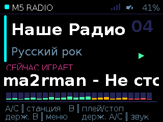
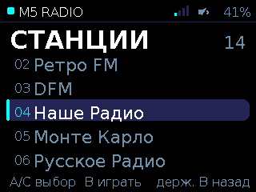
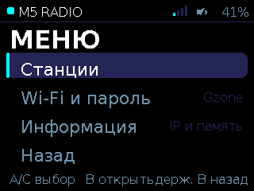
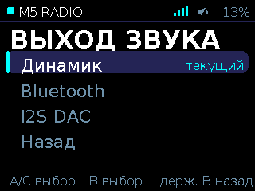
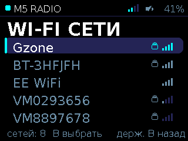
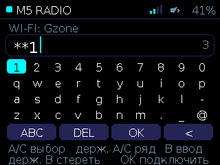
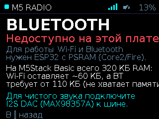
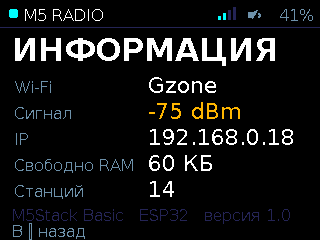

# M5Stack ESP32 Internet Radio Player

A standalone, full-featured internet radio player designed for **M5Stack Basic / Core** (ESP32, 320×240 ILI9342 display, 3 hardware buttons, built-in speaker, no PSRAM). 

Everything is controlled using just the **three front buttons (A, B, C)** — including browsing Wi-Fi networks and typing passwords via a custom on-screen virtual keyboard.

---

## Screenshots

| Now Playing Screen | Station Browser | Main Menu |
|:---:|:---:|:---:|
|  |  |  |

| Audio Output Selector | Wi-Fi Network Scanner | Virtual Keyboard |
|:---:|:---:|:---:|
|  |  |  |

| Bluetooth Info Screen | System Information |
|:---:|:---:|
|  |  |

---

## Features

- **14 Preconfigured Streams:** A curated mix of international and Russian streams across genres (Rock, Indie, Jazz, Classical, Pop, News):
  - *International:* Radio Paradise, FIP (France), KEXP (Seattle), 181.FM Beatles, Classic FM (UK).
  - *Domestic:* Europa Plus, Retro FM, DFM, Nashe Radio, Monte Carlo, Russkoye Radio, Radio Mayak, Vesti FM, Jazz FM.
- **Pure 3-Button Control:** Full navigation, station switching, volume, menus, Wi-Fi scanning, and keyboard input using click and long-press gestures.
- **On-Screen Virtual Keyboard:** Full alphanumeric input (lowercase, uppercase, digits & special symbols) with cursor, backspace, and live character preview.
- **Dynamic Live UI:**
  - Marquee scrolling for long station titles and song metadata (ICY `StreamTitle`).
  - Animated 24-bar audio spectrum visualizer (VU meter).
  - Buffer fill level bar.
  - Top status bar with live Wi-Fi signal (RSSI bars), volume percentage, and speaker status.
  - Custom Cyrillic and Latin DejaVu fonts embedded directly in Flash (`PROGMEM`).
  - Automatic CP1251 to UTF-8 transcoding for domestic radio metadata.
- **Dual Audio Output Options:**
  - *Internal DAC:* Outputs through ESP32 DAC (GPIO 25) to the built-in speaker.
  - *External I2S DAC:* Outputs 24/32-bit pristine digital audio via bottom header (`G12`, `G0`, `G2`) to modules like **MAX98357A** or **PCM5102A**.
- **Non-Volatile Storage (NVS):** Automatically remembers chosen Wi-Fi network, password, last selected station, volume, and audio output mode across reboots.
- **Interactive Serial CLI:** Complete control and headless test suite via USB UART (synthetic button presses, volume, station jump, screenshot dumps).

---

## Button Controls

| Screen | Button A | Button B | Button C |
|---|---|---|---|
| **Player** | Previous station | Play / Pause | Next station |
| *(Hold)* | Volume down | Open Main Menu | Volume up |
| **Stations** | Move cursor up | Play selected & return | Move cursor down |
| *(Hold)* | — | Back to Player | — |
| **Main Menu** | Move cursor up | Enter submenu | Move cursor down |
| *(Hold)* | — | Back to Player | — |
| **Audio Output** | Move cursor up | Select output mode | Move cursor down |
| *(Hold)* | — | Back to Menu | — |
| **Wi-Fi Scanner** | Previous network | Select network | Next network |
| *(Hold)* | — | Rescan / Back | — |
| **Password Input** | Move cursor left | Type character / Action | Move cursor right |
| *(Hold)* | Move row up | Backspace (`DEL`) | Move row down |
| **System Info** | — | Back to Menu | — |

On the password screen, the bottom row provides special keys:
- `ABC` / `abc` / `123`: Switch keyboard layout (uppercase / lowercase / numbers & symbols).
- `DEL`: Backspace.
- `OK`: Connect using the entered password.
- `<`: Cancel and return to network list.

---

## Serial Command Interface & Automation

Connect via terminal at **115200 baud, 8N1** (line ending `\n`):

| Command | Description |
|---|---|
| `A`, `B`, `C` | Short click on corresponding button |
| `AH`, `BH`, `CH` | Long hold on corresponding button |
| `V+`, `V-` | Increase / decrease volume |
| `VOL <0..255>` | Set absolute volume level |
| `ST <0..13>` | Jump directly to station index |
| `OUT DAC` | Switch to built-in DAC speaker |
| `OUT I2S` | Switch to external I2S DAC output |
| `INFO` | Print current screen, playback state, Wi-Fi status, output mode, and free heap |
| `SHOT` | Dumps current display buffer in RGB332 format (320×240 bytes) |
| `HELP` | Print command cheat sheet |

### Python Helper Scripts (`tools/`)

```bash
# Capture a live lossless screenshot directly over UART:
python3 tools/uicontrol.py shot screenshot.png

# Send button presses or commands:
python3 tools/uicontrol.py send BH       # open menu
python3 tools/uicontrol.py send ST 11    # play KEXP

# Run automated visual regression tests across all screens:
python3 tools/uitest.py
```

---

## Hardware Limitations: Wi-Fi & Bluetooth on ESP32 without PSRAM

A common question is: *«Why can't we stream internet radio over Wi-Fi to Bluetooth headphones simultaneously on M5Stack Basic?»*

### 1. The DRAM Budget & Bluedroid Stack

Standard Bluetooth headphones and speakers stream audio via the **Classic Bluetooth A2DP (Advanced Audio Distribution Profile)** profile. On the ESP32:

- **Bluetooth Controller (Baseband / Link Layer):** Closed-source binary firmware (`libbtdm_app.a`). Just turning on the Classic Bluetooth controller allocates **~70 KB of DRAM** for packet buffers, hardware descriptors, and frequency hopping tables.
- **Bluetooth Host Stack (Bluedroid / A2DP Source + SBC encoder):** Requires **~50–60 KB of RAM** for L2CAP channels, AVDTP state machines, and real-time SBC subband filter buffers.
- Total memory needed for Bluetooth A2DP Source: **~120–130 KB**.

Now consider the memory available on an ESP32 chip **without external PSRAM** (like M5Stack Basic, which has only 320 KB internal SRAM):

```
Total Internal SRAM: ~320 KB
├── FreeRTOS, system vectors, DRAM/IRAM tables:  ~60 KB
├── Wi-Fi Driver & MAC layer:                   ~60 KB
├── TCP/IP Stack (LwIP) & socket buffers:       ~40 KB
├── Application (MP3 decoder, stream buffer, UI): ~80 KB
└── REMAINING HEAP WITH WI-FI CONNECTED:         ~60–70 KB
```

Attempting to initialize Bluedroid with only ~60 KB of heap results in an immediate out-of-memory abort (`vQueueDelete` assert in `BTU_StartUp`). Even if using a lightweight host stack like BTstack, the controller alone consumes the entire free heap.

### 2. Single-Antenna Radio Coexistence (Coex Catch-22)

The ESP32 features **one physical 2.4 GHz radio and one antenna** shared between Wi-Fi and Bluetooth:

- Bluetooth A2DP requires antenna access every **15–20 ms** with absolute priority to prevent audio dropouts in the headphones.
- While Bluetooth is transmitting, **Wi-Fi reception is stalled**.
- To prevent internet audio from stuttering during Bluetooth bursts, the player needs a large stream buffer (**at least 32–64 KB / 3–4 seconds**).
- On a 320 KB chip, you cannot have both the large Wi-Fi buffer and the Bluetooth stack in RAM simultaneously. Squeezing the buffer causes continuous audio hiccups.

### 3. Why Bluetooth LE Audio (LC3) Cannot Be Used Here

Bluetooth Low Energy Audio (**LE Audio / LC3 codec / Auracast**) was introduced in the **Bluetooth 5.2** specification (2020) and requires **Isochronous Channels (CIS/BIS)** in hardware.

The classic ESP32 silicon in M5Stack Basic only implements **Bluetooth 4.2**. Its physical radio baseband lacks the hardware timers and packet framing required for Bluetooth 5.2 LE Audio.

---

## Best Suitable Boards Comparison

If you want simultaneous Wi-Fi internet streaming and Bluetooth A2DP transmission, choose an ESP32 board equipped with **PSRAM**:

| Board | Microcontroller | PSRAM | Display & Audio Hardware | Wi-Fi + BT A2DP Audio | Built-in Speaker Quality |
|---|---|---|---|:---:|---|
| **M5Stack Core2** | ESP32-D0WDQ6-V3 | **8 MB** | 320×240 Touch, I2S Amp (AW88298) | **Supported** | Crystal clear (I2S hardware amp) |
| **M5Stack Fire** | ESP32-D0WDQ6 | **4 MB** | 320×240 Display, 3 buttons, DAC Amp | **Supported** | Moderate (has PSRAM for BT) |
| **M5Stack CoreS3** | ESP32-S3 | **8 MB** | 320×240 Touch, Dual I2S (AW88298) | *LE Audio only\** | Crystal clear |
| **ESP32-WROVER / Audio Kit (LyraT)** | ESP32-WROVER-E | **4–8 MB** | ES8388 Audio Codec, 3.5mm jacks | **Supported** | Audiophile grade |
| **M5Stack Basic (This project)** | ESP32-D0WDQ6 | **0 KB** | 320×240 Display, 3 buttons, DAC Amp | *Requires Ext. Module* | DAC hiss on internal speaker |
| **Heltec WiFi LoRa 32 V3** | ESP32-S3 | **0 KB** | 0.96" 128×64 Mono OLED, LoRa | **Not supported** | No DAC/speaker |

*\*Note on ESP32-S3 boards (CoreS3, Heltec V3): Espressif removed Classic Bluetooth (BR/EDR) from ESP32-S2/S3/C3/C6 chips. They only support BLE and cannot connect to standard consumer Classic A2DP Bluetooth headphones/speakers.*

---

## Eliminating Speaker Hiss on M5Stack Basic (I2S DAC Upgrade)

On M5Stack Basic, the internal NS4148 Class-D amplifier is permanently enabled on the board (its shutdown pin is hardwired high), picking up ground and power supply noise, while the 8-bit DAC produces quantization hiss at low digital volumes.

The cleanest and easiest fix is adding an external **MAX98357A I2S 3W amplifier module** (costs ~$2 on AliExpress/Amazon):

### Wiring Diagram

Connect the MAX98357A to the bottom female header pins of the M5Stack Basic:

```
MAX98357A          M5Stack Basic Header
───────────────────────────────────────
VIN        ───►    5V
GND        ───►    GND
BCLK       ───►    G12 (GPIO 12)
LRC        ───►    G0  (GPIO 0)
DIN        ───►    G2  (GPIO 2)
GAIN       ───►    GND (12dB gain) or 5V (3dB gain)
SD_MODE    ───►    Unconnected (mixes L+R to mono)
SPEAKER    ───►    Any 4Ω - 8Ω 3W speaker
```

### Activating I2S Mode

1. From the M5Stack menu: Navigate to **«Выход звука» (Audio Output) → «I2S DAC»**.
2. Or via Serial command: Send `OUT I2S`.

The internal noisy DAC amplifier is completely stopped, and pristine, jitter-free 24-bit audio streams through the I2S bus.

---

## Building and Flashing

### Requirements

- [PlatformIO Core](https://platformio.org/) or VS Code with PlatformIO extension.
- Micro-USB cable connected to the M5Stack Basic.

### Build and Upload

```bash
# Clone the repository
git clone git@github.com:anton-b/M5Stack_ESP32_radio.git
cd M5Stack_ESP32_radio

# Build firmware
pio run

# Upload to M5Stack (port is automatically detected)
pio run -t upload

# Open serial monitor
pio device monitor -b 115200
```

If flashing via WSL2 on Windows, attach the USB bridge first:

```powershell
# In Windows PowerShell:
usbipd list
usbipd attach --wsl --busid <BUSID>
```

---

## Project Structure

```
├── platformio.ini              # PlatformIO configuration & library dependencies
├── src/
│   ├── main.cpp                # Core application, UI, state machine & buttons
│   ├── stations.h              # Radio station URLs, names & genres
│   ├── AudioOutputM5Speaker.h  # Zero-copy audio driver for M5.Speaker
│   ├── AudioOutputBT.h         # Ring-buffer audio output with 44.1 kHz resampling
│   └── fonts/                  # Custom DejaVu fonts with full Cyrillic & Latin glyphs
│       ├── font8.h             # 8pt regular (hints, status, subtext)
│       ├── font11.h            # 11pt regular (menu items, genres, inputs)
│       ├── font16b.h           # 16pt bold (headings, titles, track name)
│       └── font22b.h           # 22pt bold (station callsigns, branding)
├── images/                     # Screenshots for documentation
└── tools/
    ├── uicontrol.py            # Serial CLI & remote screenshot capture utility
    └── uitest.py               # Automated visual test runner
```

---

## License

MIT License. Feel free to modify and build upon it!
